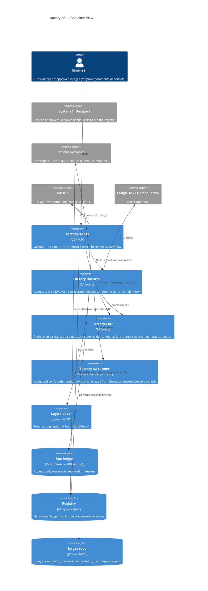
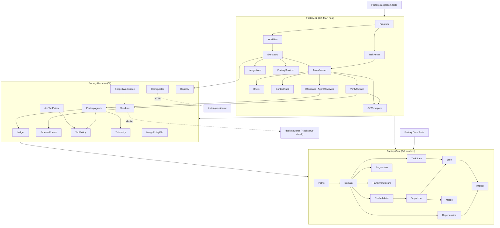

# Architecture — factory-s2 (System 2: coding pipeline)

> Living document. Updated at the end of every /plan execution and
> whenever module boundaries or interfaces change.
> Source of truth for blast radius assessment, onboarding, and enterprise
> architecture aggregation.
> Last updated: 2026-10-13 — Token gate reads the frozen tokens: `Handover.DesignTokens: string option` (interface widening: handover.yaml `tokens` file text, json `designTokens`), so the gate judges what was frozen rather than the live registry; `FACTORY_TOKEN_LINT_CMD` runs only when the handover carries tokens. Previously 2026-10-13 — Scheduler wired to the registry: `Core/Board.fs` (pure: ledger facts -> `Candidate`s, Ready from a `handover` row naming the item, Done only through `Evidence.create`; `stale` from the latest `item_recheck` until re-frozen; `wipLimit`), `LedgerFact.ItemFrozen` and `ItemRecheck.reasons`, `WorkDigestReport.PullPlanAsync`, CLI `factory-s2 pull-plan --registry` (reports; nothing is pulled, item_pulled stays human-only). Ticks are not in the ledger, so an item with a checklist/review never reaches Done here; priority is 0 until the work file carries one. Previously 2026-10-13 — Digest notification policy: `Digest.alertKeys/newAlerts` (only new Needs/Failed rows ping; cleared or already-announced rows never), CLI `digest --notify-state <file>` prints `NOTIFY <key>` lines and records them. Previously 2026-10-13 — S4 work metrics: `Core/Metrics.fs` (pure: throughput per ISO week and target kind from the digest's Done, lead time pull->done, human wait, open waits, conflict deferrals, re-check rate, escapes by origin; no freeze row and no acceptance pass rows exist in the ledger, so freeze->done lead time and acceptance first-pass are not computed), `LedgerFact.ItemRecheck`/`EscapeRecorded` read by `WorkRegistryReader`, CLI `factory-s2 metrics --registry`. Previously 2026-10-13 — Token gate: `Core/DesignTokens.fs` (W3C tokens.json -> typed tokens, CSS custom properties, text-size minimum; `TokenLint.translationErrors` maps raw-value violations to `TranslationError` via task `writes`), `Harness/Verify/StylelintReport`, `VerifyRunner.TokenLintAsync`, `FACTORY_TOKEN_LINT_CMD` (off when null; runs in integration verify only when the registry has `design-tokens/tokens.json`), ledger kind `token_lint_violation` (S2 ledger only, not projected). Image gets stylelint + `docker/runner/stylelint/stylelint.config.json` (image not rebuilt/verified here). Previously 2026-10-13 — Bug intake: `DefectOrigin.parse/toLedger` (designc's spec_gap|design_error|translation_error|gate_gap, each with its reference), `Harness/Registry/BugIntake` walks the `Defect` lifecycle (failing acceptance spec, origin, NewGate) and only then writes a designc `escape` row (traces = the spec) on an `intake-<id>` run stream, folded to designc.jsonl; CLI `factory-s2 intake --registry`. Not yet: Playwright CLI tool policy, token lint, UX gates. Previously 2026-10-13 — UI acceptance gate wired into integration verify: `Handover.WorkItem` (interface widening, `work_item`), drift check of `tests/acceptance/**` against the frozen hashes runs first (hard fail `acceptance_specs_modified`, no check runs), then `FACTORY_ACCEPTANCE_CMD` (default `npx playwright test --reporter=json`, report via `PLAYWRIGHT_JSON_OUTPUT_NAME`) runs the specs; each failing spec -> `ui_acceptance_failed` ledger row per task whose element it exercises (`Harness/Verify/PlaywrightReport`, `VerifyRunner.AcceptanceAsync`), projected to the registry (task = work item) only when the handover names one. Failed acceptance ends the run `integration_failed`; re-running only the affected tasks is not built. Previously 2026-10-13 — UI acceptance, pure core: `Handover.AcceptanceSpecs` (interface widening: `specs` paths + frozen hash, read by the reader, `acceptanceSpecs` in handover.json, absent = none) and `Core/UiAcceptance.fs` (`AcceptanceSpecs.drift` hash check of `tests/acceptance/**`, failing spec -> AC + element -> `TranslationError` per task; `FailingCheck`/`Defect` lifecycle where Classified needs a reproduction and closing needs a `NewGate`). No Playwright runner yet. Previously 2026-10-13 — Work digest: `Core/Digest.fs` (pure: Needs decision / Failed a gate / Done since last look / Waiting from `LedgerFact`s; a Done claim off main or without evidence is Failed), `Harness/Registry/WorkRegistryReader` (designc `work/*.yaml` via `WorkItem.create`, requirement and dependency existence, ledger rows -> facts) and `WorkDigestReport`; CLI `factory-s2 digest --registry`. Previously 2026-10-13 — Work intake, S2 side: `Core/Work.fs` (WorkItem smart constructor over designc's work-file format, Evidence judged from facts, WorkState machine) and `Core/Scheduler.fs` (pure pull plan: dependency, conflict, budget, WIP and re-check gates; a person still pulls) have no dependents yet. Registry writes are now per-run streams `ledger/runs/<run_id>.jsonl` merged by a single-writer `LedgerFold` (lock `ledger/.fold.lock`, dedupe by event_id), so concurrent runs never write the same main stream; `RegistryStreams` mirrors designc's kind->stream map and is contract-tested against the fixture. Previously 2026-10-13 — Item handovers: the reader accepts `designc.handover.elements/2` (fixture `handover-elements-2.json`); `reserved` paths join `Handover.ProtectedPaths`, so plan validation (`ProtectedWrite`) and the merge/workspace protected-path handling enforce `tests/acceptance/**` with no new mechanism; `ElementSpec.InScope` (absent = true) marks context-only elements, and `PlanError.OutOfScopeElement` rejects a task that links one. `ledger_schema.json` fixture re-copied. Previously 2026-10-11 — Handover reader conforms to Designc's published `elements.json` (schema `designc.handover.elements/1`, owned by Designc; example copied to `Fixtures/designc/handover-elements.json`, `DesigncHandoverElementsContractTests`): elements, code areas, risk, relationships and the event vocabulary come from it, `DslModel.cs` is deleted (S2 no longer parses the DSL), and a handover without `elements.json` is rejected (re-freeze it in Designc). Designc stays agnostic about which coding agent consumes the handover. Previously 2026-10-09 — Fitness debt alerts: `Fitness.debt` (baseline element pairs the code still crosses), `QualityGate.FitnessDebtAsync`, TeamRunner ledgers each pair once per task as `asbuilt_edge` (stage quality, outcome debt, payload {from,to}; never blocking), `RegistryLedgerProjector` writes one Designc `asbuilt_edge` row per pair per run on pipeline.jsonl. `npm.rebuild` ships empty (added per repo by a human). Earlier: TS import rules: `quality.forbid` also judges TS/JS imports (`TsImportEdges` via dependency-cruiser in the runner image, `TsGate` ratcheted against the integration branch, only when a ts/js file changed). Earlier: UI regression guard: `Core/UiGuard.fs` (pure: contract + baseline vs current UI items), `S2/Quality/UiInventory` (heuristic scan: data-testid, React Router routes, UI test titles, skip/fixme/only), `UiGate` (worktree vs a baseline checkout of the integration branch), `UiContractFile` (protected `.factory/ui-contract.yaml`), `quality.ui` in the policy. Runs in every task's verify once green; a removal parks the task (source `ui`, options A accept / B restore / C guidance); A is ledgered as `ui_accepted` and authorises those items for the task. Earlier: decision checks of kind `p` now run on a compiled model: `PModel.Prepare` copies the registry's behaviour/*.p into a scratch dir under the run with a .pproj, `IntegrationVerifyExecutor` runs `p compile` there in the sandbox ("P compile" outcome) and the `p check` commands run in that dir (found by live8: the registry has sources only, so every `p check` failed). Earlier: namespace fitness rules via ArchUnitNET: `quality.forbidNamespaces` (dotted globs), `NamespaceEdges` (ArchUnitNET over a MetadataLoadContext, so target assemblies are described, never executed), `NamespaceGate` (builds the worktree and a baseline checkout in the sandbox, ratchets with `Fitness.newRuleViolationsSince`), wired into `TeamRunner.QualityLinesAsync`. Earlier: flaky re-run: `quality.flaky` (substrings) in the protected policy; `GatedSandboxFactory(isFlaky, onFlakyRetry)` re-runs a plain failure once alone, second answer stands, ledgered as `flaky_retry`. Earlier: TS complexity now verified end to end in the image: `EslintRunner` uses the image's own config (`docker/runner/eslint/eslint.config.mjs`, typescript-eslint; the repo's eslint config is not consulted); before this it returned no metrics for .ts. Earlier: human follow-up QA (`AgentQaRunner.RerunAsync` reads the `tests/qa/manifest.json` the first run left and re-measures on baseline + integrated without the author; CLI `factory-s2 qa --run-id`; `IQaRunner` unchanged). Earlier: QA environment (`QaEnvironment` in Harness/Sandbox: qa-env.yaml services on a private `--internal` docker network, `DockerSandboxOptions.Network`, `QA_<NAME>_HOST` env; started per QA run by `AgentQaRunner` when the sandbox is docker). Earlier: QA author agent (`AgentQaRunner`, `Roles.Qa`, tools `submit_qa_tests`, writes only under tests/qa; runs each test on a base-branch checkout and the integrated result; wired in `Program` only when `.factory/qa-env.yaml` exists). Earlier: hand-written fitness rules (`quality.forbid` in the protected policy file; `Fitness.forbidden`, `QualityGate.ForbiddenAsync`; project references only). Earlier: per-file baseline mutation score (`GitWorkspace.BaselineCheckoutAsync`: a throwaway detached checkout of the integration branch, mutated only for files the gate would fail). Earlier: equivalent-mutant declaration (TestAuthor `declare_equivalent`, `IReviewer.ConfirmEquivalentsAsync` with `confirm_equivalents`; confirmed claims go into `Mutation.check`). Earlier: F# quality adapter (new project `Factory.Quality.FSharp`, FSharp.Core 8.0.102 -> 8.0.400 for FCS), coverage via coverlet (`CoverageRunner`, `quality.coverage`). Earlier: Runner image wiring: `StrykerRunner` (real, in the image), npm rebuild after the restore window + `InstallScriptReport` on the PR body, `EslintRunner` into `QualityGate` for .ts/.tsx. Earlier: QA (strand 6): `Core/Qa.fs` (judge: new vs characterisation, escapes), `QaEnvFile` (protected qa-env.yaml, digest-pinned services,
> fidelity gaps), `IQaRunner` seam + `QaGate` brief, `IntegrationVerifyExecutor` runs QA after the checks (qa_failed / qa_unrunnable end the run unmerged).
> The QA author agent and the sibling-container environment are not built yet.
> Previously 2026-10-08 — npm gate + TS quality (strand 5): `Core/PackageJsonChange.fs` (package.json/lockfile/.npmrc allow-list, via `Core.ReviewRestoreInput`),
> `RestoreGate` plans `npm ci --ignore-scripts` per lockfile directory, `NpmPolicyFile` (`npm.rebuild`), `S2/Quality/EslintMetrics`. Image has no node yet.
> Previously 2026-10-08 — mutation (strand 4): `Core/Mutation.fs` (score, 80% gate per file on changed lines, confirmed equivalents),
> `RedKind.AgainstMutant`, `S2/Quality/{StrykerReport,IMutationRunner}`, `quality.mutation` policy; survivors return the task to the TestAuthor
> (`Verifying + ReturnedToTestAuthor`). The real Stryker runner is not installed yet (seam only).
> Previously 2026-10-08 — CPU gate + timeout rule (strand 3.1): `HeavyGate`/`GatedSandboxFactory` wrap every sandbox;
> a timed-out check is never evidence (`Verifying + NeedsDecisionRaised -> Blocked`, parked as "environment").
> Also: `Handover.Relationships` (modelled dependencies; old handovers have none) and fitness (3.5).
> Also: quality ratchet for C# (strand 3.2/3.3): `Core/Quality.fs`, `S2/Quality/{CSharpMetrics,Cobertura,QualityGate}`, `QualityPolicyFile`.
> Previously 2026-10-08 — reviewer + provider seam (strand 2 of PLAN-QUALITY.md): the review is the fourth gate
> (`Reviewing` state, `Review.fs`, `IReviewer`/`AgentReviewer` on a reviewer pool apart from the implementer's,
> `ModelGateways`, independence stamped in the ledger and the PR body).
> Previously 2026-10-08 — context cut (strand 1 of PLAN-QUALITY.md): `ContextPack` (task-planner nominations
> via `submit_approach` + deterministic defaults, frozen per task, refreshed each turn), `TurnBudget` (15 tool
> calls per acting turn, then verify), `ToolResultTrimmer` (older tool results stubbed).
> Previously 2026-10-07 — gated restore window: `RestoreGate` restores every project on disk (live5:
> a test project outside the sln was never restored), reviews changed restore inputs against HEAD with
> `ProjectFileChange`'s allow-list before the network opens, and pins sources to nuget.org
> (`/etc/factory/nuget.config` in the image). A refusal runs no checks and goes back to the TestAuthor
> (`RedReading.Refused`); `ICommandSandbox` gained a default `RestoreRefusal`. Before that, needs-decisions carry options: `raise_needs_decision` takes ≥2 options
> (A, B…, summary, consequence) and a recommendation, projected into the registry row's payload;
> designc answers with `payload.option`, an unknown option keeps the run parked. Before that, live5: the planner submits its plan through the `submit_plan` tool
> (input schema = plan.schema.json, validated in-call, at most 3 per turn) instead of free-text JSON;
> the schema is no longer in the brief. `pobserve-check` gains `--expect-violation` (negative checks),
> fails logs with no spec events (exit 3) and names undeclared marked events; the validator rejects
> `! pobserve-check`. Before that, live4 fixes: keyed logging contract; segment-wise
> glob overlap.

## System Overview

System 2 of the design-to-code factory. It takes a handover frozen by System 1 (Designc) and
turns it into merged code in a target repo:
- A planner agent drafts tasks.
- F# rules validate the plan and dispatch it into teams and waves.
- A per-team task loop drives the agents (task planner, TestAuthor, Implementer) inside scoped git
  worktrees. Their commands run in a Docker sandbox.
- Deterministic verify decides pass or fail: red evidence, green, a stashed-implementation run and
  a pass-to-pass check.
- Integration verify runs the whole suite, PObserve and each bound decision's checks.
- A merge policy (auto or tiered, with hard blocks) merges, or opens the PR.

Every step is written to the run ledger and projected into the registry ledger for System 4. Agents
propose; deterministic code decides. The canonical domain vocabulary is
`Designc/app/UBIQUITOUS_LANGUAGE.md`: System 1 owns the contract and this repo adopts its terms.

## Tech Stack

| Layer | Technology | Version |
|-------|-----------|---------|
| Rules (domain) | F# library, FS0025 as error | FSharp.Core 8.0.102, net9.0 |
| Harness | C# library | net9.0; Microsoft.Agents.AI(.OpenAI) 1.15.0, Anthropic 12.49.0, Microsoft.AgentGovernance [5.0.0], OpenTelemetry 1.19.1, YamlDotNet 18.1.0 |
| Host | C# console app, MAF workflows | Microsoft.Agents.AI.Workflows 1.15.0 |
| Sandbox image | Docker Engine CLI, `docker/runner` | .NET 9 SDK, JDK 17, P 3.1.0, PObserve CLI built from p-org/P@260da928 |
| Sidecar / parser | Python 3 (Laya sidecar), Java 17 (PObserve parser) | — |
| Tests | F# console runner (Core), xUnit 2.9.2 (integration; Docker and live tests opt-in) | `dotnet run --project tests/Factory.Core.Tests`, `dotnet test tests/Factory.Integration.Tests` |

## C4 Level 2 — Container Diagram

## Module Map

| Module | Responsibility | Key Types | Dependents | Integrations |
|--------|---------------|-----------|------------|-------------|
| `Factory.Core/Paths.fs` | Safe globs: create, match, overlap (over-approx), containment (under-approx) | `PathPattern` | Domain, PlanValidator, Dispatcher, Merge, Json, Interop, ScopedWorkspace, DesigncHandoverReader, Briefs, TeamRunner | — |
| `Factory.Core/ProjectFileChange.fs` | Allow-list for changes to files `dotnet restore` reads (project files, Directory.Packages.props; nuget.config/global.json/.props/.targets refused) | `ProjectFileChange.review` | Interop, RestoreGate | — |
| `Factory.Core/Domain.fs` | Handover, plan and verify types | `Handover`, `ElementSpec`, `BoundDecision`, `PlannedTask`, `VerifyEntry` | every Core module after it, Harness, S2, tests | — |
| `Factory.Core/ContextPack.fs` | Context pack for acting turns: deterministic defaults, validated nominations (never blocking), task-written files, budget fitting (60k chars) | `ContextPack`, `Selection`, `PackFile` | TaskLoop, ScopedWorkspace (submit_approach), Briefs | — |
| `Factory.Core/Review.fs` | Review types and pure rules: findings (must cite a diff line), unified-diff parsing, validation, routing (weak tests -> TestAuthor), re-review limits, independence | `Finding`, `FindingCategory`, `ReviewResult`, `ReviewEvidence`, `Independence`, `Diff`, `Review` | TaskState, Json, Interop, TaskLoop | — |
| `Factory.Core/PlanValidator.fs` | Plan rules (collects all errors); sole constructor of `ValidatedPlan` | `PlanError`, `ValidatedPlan` | Dispatcher, Interop, S2 | — |
| `Factory.Core/Dispatcher.fs` | Overlapping writes -> teams; team DAG -> waves | `Team`, `Wave`, `DispatchPlan` | Merge, Json, Interop, S2 | — |
| `Factory.Core/TaskState.fs` | Task lifecycle, budgets, phases (TestAuthor/Implementer); `Passed` needs three-gate evidence; `replay` | `TaskState`, `TaskEvent`, `RedEvidence`, `VerifiedEvidence`, `Limits` | Json, Interop, RegistryLedgerProjector, TeamRunner | — |
| `Factory.Core/Regression.fs` | Pass-to-pass: baseline-passing tests that no longer pass | `TestResult` | Interop, VerifyRunner | — |
| `Factory.Core/PackageJsonChange.fs` | Allow-list for npm restore inputs (registry specs only, no install-time scripts, lockfile from the pinned registry) | `PackageJsonChange` | RestoreGate (via `Core.ReviewRestoreInput`) | — |
| `Factory.Core/Qa.fs` | Judges requirement-level QA tests run on baseline and integrated result: coverage, vacuous, not done, escape | `QaTest`, `QaFinding`, `Qa` | IntegrationVerifyExecutor | — |
| `Factory.Core/Mutation.fs` | Mutant statuses, score, per-file gate over changed lines, confirmed equivalents | `Mutant`, `MutantStatus`, `MutationThresholds`, `MutationViolation`, `Mutation` | TaskLoop, tests | — |
| `Factory.Core/Quality.fs` | Neutral per-function metrics, CRAP, the ratchet (new code meets thresholds, touched code no worse) | `FunctionMetrics`, `QualityThresholds`, `ChangedRange`, `QualityViolation`, `Quality` | TaskLoop, QualityGate | — |
| `Factory.Core/Fitness.fs` | Code edges between elements must be modelled relationships; baseline element pairs are debt (`Fitness.debt`, alerted as `asbuilt_edge`) | `CodeEdge`, `FitnessViolation`, `Fitness` | QualityGate | — |
| `Factory.Core/UiGuard.fs` | UI regression rule: contract/baseline items gone (or tests now skipped) and not authorised are violations | `UiItem`, `UiItemKind`, `UiViolation`, `UiGuard` | UiGate | — |
| `Factory.Core/HandoverClosure.fs` | Handover outcome: delivered only when merged and every decision check passed | `HandoverOutcome` | Interop, RegistryLedgerProjector | — |
| `Factory.Core/Regeneration.fs` | Re-frozen handover vs plan: changed decisions -> tasks to re-run | `Regeneration` | Interop, S2 (Dispatcher, TeamRunner) | — |
| `Factory.Core/Merge.fs` | Merge tier (max over rules), enforcement (auto/tiered), hard blocks | `MergeTier`, `MergePolicy`, `MergeEnforcement`, `MergeBlock`, `MergeVerdict` | Interop, MergePolicyFile, MergeExecutor | — |
| `Factory.Core/Json.fs` | Plan/handover/dispatch/task-event codecs | — | Interop | — |
| `Factory.Core/Interop.fs` | C#-friendly facade | `Core`, `PlanValidation`, `FactoryRejectedException` | Harness, S2 | — |
| `Factory.Harness/FactoryAgents.cs` | Builds every agent: provider client per tier, governed tool calls, gen_ai spans | `GatewayOptions`, `ModelProvider`, `AgentScope`, `FactoryAgents` | S2 executors, TaskLoop | Anthropic API / OpenAI-compatible gateway |
| `Factory.Harness/ModelGateways.cs` | Implementer and reviewer gateway options from env (`FACTORY_REVIEWER_*`, each falling back to the implementer's), model family, start-up independence check (same-family refused unless `FACTORY_REVIEWER_SAME_FAMILY=allow` and merges are dry-run) | `ModelGateways` | FactoryAgents, Program | — |
| `Factory.Harness/ToolPolicy.cs` | Role allow-list (fallback and contract double) | `IToolPolicy`, `RoleAllowListPolicy`, `Roles` | FactoryAgents, AcsToolPolicy | — |
| `Factory.Harness/Governance/AcsToolPolicy.cs` | AGT/ACS policy per role from `policies/s2/*.yaml` | `AcsToolPolicy` | Program | Microsoft.AgentGovernance |
| `Factory.Harness/TurnBudget.cs`, `ToolResultTrimmer.cs` | Per-turn tool-call cap (warn 12, stop 15, `check_quality` exempt); stubs tool results older than the last 5 in what the model sees | `TurnBudget`, `TrimmingChatClient` | FactoryAgents, TaskLoop | — |
| `Factory.Harness/Configurator.cs` | plan/act/escalate + tier: heuristic, Laya, fallback | `IConfigurator`, `HeuristicConfigurator`, `LayaConfigurator`, `FallbackConfigurator` | TaskLoop, Program | Laya sidecar (HTTP) |
| `Factory.Harness/ScopedWorkspace.cs` | Agent tools; refuses writes outside the phase's paths; runs commands in the sandbox | `ScopedWorkspace`, `TurnSignals` (incl. `submit_approach`, `Capped`) | TaskLoop, Planner | File system, sandbox |
| `Factory.Harness/Sandbox/*` | Command sandbox: Docker container per team (default) or scrubbed local | `ISandboxFactory`, `ICommandSandbox`, `DockerSandbox`, `LocalSandbox`, `RestoreGate`, `HeavyGate`, `GatedSandboxFactory` | ScopedWorkspace, VerifyRunner, TeamRunner, Program | Docker Engine CLI |
| `Factory.Quality.FSharp/FSharpMetrics.fs` | F# quality adapter: FSharp.Compiler.Service parse (syntax only) to neutral `FunctionMetrics` (cyclomatic from if/loops/match clauses/`&&`/`||`); own project so the compiler dependency stays out of Core; depends on Core only | `FSharpMetrics.measure` | `QualityGate` | FSharp.Compiler.Service 43.8.400 (pins FSharp.Core 8.0.400) |
| `Factory.Harness/Registry/*` | Designc handover reader (hash-checked, conforms to Designc's `elements.json` contract; never parses the DSL); ledger projection (tasks, needs-decisions, checks, `asbuilt_edge` debt, handover closed); needs-decision ids/resolutions | `DesigncHandoverReader`, `RegistryLedgerProjector`, `RegistryNeedsDecisions` | HandoverInput, executors | Registry repo files |
| `Factory.Harness/Policy/MergePolicyFile.cs` | `.factory/policy.yaml` + env override | `MergePolicyFile` | FactorySettings | Target repo file |
| `Factory.Harness/Telemetry/FactoryTelemetry.cs` | OTel attribute contract, run/task spans, task_passed score, tracer provider | `FactoryTelemetry` | FactoryAgents, Workflow, TaskLoop, Program | OTLP (Langfuse) |
| `Factory.Harness/Ledger.cs` | Ledger events (trace_id on every row), JSONL impl | `ILedger`, `LedgerEvent`, `LedgerKinds` | most of Harness and S2 | File system |
| `Factory.Harness/ProcessRunner.cs` | Process with timeout + tree kill | `ProcessRunner`, `ProcessResult` | Sandboxes, GitWorkspace, Integrations | OS processes |
| `Factory.S2/Workflow.cs` | MAF graph + host (merge-approval RequestPort) | `S2Workflow`, `WorkflowHost` | Program, tests | MAF runtime |
| `Factory.S2/Executors/*` | Planner (reuses the previous plan on `--since`), PlanValidator, Dispatcher (writes regeneration.json), Waves (needs-decision park/resume), IntegrationVerify, Merge, Finalize | executor classes, `Messages.cs` | Workflow | Registry |
| `Factory.S2/Teams/TeamRunner.cs` | Per-team loop; TaskLoop drives one task (red, green, stash check, P2P, scope); carries regeneration-unaffected tasks | `TeamRunner`, `TaskLoop`, `TeamResult` | WaveExecutor, TaskRerun | — |
| `Factory.S2/Teams/Reviewer.cs`, `AgentReviewer.cs` | The review seam: `IReviewer` (+ `Independence`), request/verdict types; the agent implementation runs `Roles.Reviewer` read-only with `submit_review` and treats any turn without it as malformed; `ConfirmEquivalentsAsync` asks which TestAuthor equivalence claims it accepts (`confirm_equivalents`; no answer = none) | `IReviewer`, `ReviewRequest`, `ReviewVerdict`, `AgentReviewer` | TaskLoop, FactoryServices, Program | Reviewer model pool |
| `Factory.S2/Teams/TaskRerun.cs` | k independent attempts at one task: pass rate, turns, tokens | `TaskRerun`, `RerunReport` | Program (`rerun`) | — |
| `Factory.S2/Teams/Briefs.cs` | Per-turn briefs (incl. the PObserve logging contract); prompts from `prompts/*.md` | `Briefs` (`Task` takes the context pack) | TaskLoop, Planner | — |
| `Factory.S2/Verify/*` | Verify entries in the sandbox, each from the tree as found, cleanup always, JUnit parsing, baseline/regression | `VerifyRunner`, `VerifyOutcome`, `JUnit` | TaskLoop, IntegrationVerify | Sandbox, GitWorkspace |
| `Factory.S2/Quality/*` | C# adapters (Roslyn syntax metrics, Cobertura join, csproj edges) and the task-diff gate; policy from `.factory/policy.yaml` `quality:` (`QualityPolicyFile`; UI guard: `quality.ui` + `UiContractFile`) | `CSharpMetrics`, `Cobertura`, `CsprojEdges`, `QualityGate`, `StrykerReport`, `IMutationRunner`, `EslintMetrics`, `IQaRunner`, `QaGate`, `UiInventory`, `UiGate`, `TsImportEdges`, `TsGate` | TaskLoop (`QualityOutcomeAsync`, `check_quality`) | GitWorkspace, Roslyn |
| `Factory.S2/Git/GitWorkspace.cs` | Integration branch, worktree per team, stash, leave-as-found, idempotent merges | `GitWorkspace` | TeamRunner, TaskRerun, VerifyRunner, executors | git |
| `Factory.S2/Integrations.cs` | PRs (gh / dry-run), approval comments, human channel | `IPullRequests`, `IApprovalComments`, `GhCliPullRequests`, `IHumanChannel` | MergeExecutor, WorkflowHost, Program | GitHub (gh CLI) |
| `Factory.S2/HandoverInput.cs` | `--handover` file or Designc dir -> frozen JSON | `HandoverInput` | Program | Registry |
| `Factory.S2/FactoryServices.cs` | Settings from env, run-dir paths, service bag, re-validating loaders | `FactorySettings`, `FactoryServices`, `RegenerationFile` | every executor, TeamRunner, TaskRerun, Program | env vars |
| `docker/runner` | Runner image (`build.sh`) | — | DockerSandbox (by image name) | Docker |
| `tools/pobserve-parser` | `EventLineParser` (`pobserve <event> <payload> key=<id>` -> P events, one partition per key), `pobserve-check` | — | runner image, `FACTORY_POBSERVE_CMD` | PObserve CLI |
| `tools/laya-sidecar` | `/decide` HTTP sidecar; `laya_adapter.py` is the one binding point | — | LayaConfigurator | Laya |
| `policies/s2/*.yaml` | ACS policies per role (`planner`, `task-planner`, `reviewer`, `test-author`, `implementer`) | — | AcsToolPolicy | — |

## Module Dependency Diagram

## High-Centrality Modules

Modules with multiple dependents — highest blast radius on change.
Used by structural-centrality-guard to determine escalation threshold.

| Module | File Path | Dependent Count | Dependents |
|--------|-----------|----------------|-----------|
| Domain | `src/Factory.Core/Domain.fs` | 12+ | every Core module after it, Harness, S2, tests |
| Paths | `src/Factory.Core/Paths.fs` | 10 | Domain, PlanValidator, Dispatcher, Merge, Json, Interop, ScopedWorkspace, DesigncHandoverReader, Briefs, TeamRunner |
| Ledger | `src/Factory.Harness/Ledger.cs` | 9 | FactoryAgents, DockerSandbox, RegistryLedgerProjector, VerifyRunner, FactoryServices, PlanningExecutors, RunExecutors, TeamRunner, TaskRerun |
| FactoryServices | `src/Factory.S2/FactoryServices.cs` | 7 (gained `Reviewer`) | PlanningExecutors, RunExecutors, Workflow, TeamRunner, TaskRerun, Messages, Program |
| Sandbox | `src/Factory.Harness/Sandbox/ICommandSandbox.cs` | 6 | Local/DockerSandbox, ScopedWorkspace, VerifyRunner, FactoryServices, TeamRunner, Program |
| Interop | `src/Factory.Core/Interop.fs` | 6+ | every Harness/S2 file that uses `Core.*` |
| PlanValidator | `src/Factory.Core/PlanValidator.fs` | 5 | Dispatcher, Interop, FactoryServices, PlanningExecutors, Program |
| Telemetry | `src/Factory.Harness/Telemetry/FactoryTelemetry.cs` | 4 | FactoryAgents, Workflow, TeamRunner, Program |
| TaskState | `src/Factory.Core/TaskState.fs` | 5 | Json, Interop, Review (types), RegistryLedgerProjector, TeamRunner |
| ProcessRunner | `src/Factory.Harness/ProcessRunner.cs` | 4 | DockerSandbox, LocalSandbox, GitWorkspace, Integrations |
| Regeneration | `src/Factory.Core/Regeneration.fs` | 4 | Interop, FactoryServices, PlanningExecutors, TeamRunner |

## Integration Points

| System | Protocol | Direction | Canonical Name | Notes |
|--------|---------|-----------|---------------|-------|
| System 1 registry | Files (git repo) | In/Out | Designc registry | Reads `handovers/<id>/` (hash-checked; elements, code areas, risk, relationships and events from Designc's `elements.json`, schema `designc.handover.elements/1` or `/2`); appends the S2 projection to `ledger.jsonl`; needs-decisions raised there with `payload.options`, resolved with `payload.option` and/or `payload.note` |
| Model provider | HTTPS | Out | Anthropic API, or APIM -> LiteLLM | `FACTORY_PROVIDER=anthropic|openai`; key never reaches sandbox, ledger or traces |
| GitHub | gh CLI | Out/In | GitHub | PR create, `/approve` and `/verified` comments from the allow-list, squash merge; dry-run writes to `.factory/runs/<id>/` |
| git | CLI | Out | target repo | integration branch, worktrees under the state dir |
| Docker Engine | CLI | Out | factory-s2-runner | container per team, `--network none` apart from the restore window, opened only when RestoreGate passes; sources pinned to nuget.org |
| Laya | HTTP `/decide` | Out | Laya sidecar | optional (`FACTORY_LAYA_URL`); heuristic fallback, decider ledgered |
| Langfuse / OTLP | OTLP | Out | Langfuse | only when `OTEL_EXPORTER_OTLP_ENDPOINT` set; content off unless `FACTORY_OTEL_CAPTURE_CONTENT=1` |
| PObserve | CLI in the runner image | Out | PObserve | `pobserve-check <specs> <Spec> <logs>` via `FACTORY_POBSERVE_CMD`; exit 2 spec violation, 4 parse error |
| Human | Console / RequestPort | In/Out | — | merge approval without `--github` |

## Domain Rules Extracted

| Rule | Location | Type | Notes |
|------|---------|------|-------|
| The task-planner's context nominations are validated and never block (bad paths are reported back, defaults remain); the selection is frozen at the approach turn and recovered from the `task_plan` ledger row, contents are read fresh each turn | `ContextPack.fs`, `TaskLoop.PlanTurnAsync`/`ContextPackAsync` | Invariant | PLAN-QUALITY.md strand 1 |
| An acting turn is capped at 15 tool calls (`check_quality` exempt); at the cap it counts as done and verify (or the red run) judges the worktree | `TurnBudget.cs`, `FactoryAgents.GovernedToolCallAsync`, `TaskLoop.ActTurnAsync` | Invariant | live1: a 514k-token, 31-call TestAuthor turn |
| A task cannot pass without a review of its green diff: findings must cite a line in the diff (the rest are dropped and ledgered), design findings are advice, weak tests go to the TestAuthor first; three blocking rounds, then it parks for a designer (accept / reject / send back); a malformed review is asked for once more, then parks, never passes; a re-review may add findings only on lines the fix changed | `Review.fs`, `TaskState.fs` `Reviewing`, `TaskLoop.ReviewAsync` | Invariant (type-enforced gate) | PLAN-QUALITY.md strand 2 |
| The reviewer is a different pool from the implementer; unknown model family counts as the same; same-family needs `FACTORY_REVIEWER_SAME_FAMILY=allow` and dry-run merges, and is stamped `independence: same-family` on the ledger and PR | `ModelGateways.cs`, `RunExecutors.ReviewSectionAsync` | Invariant | PLAN-QUALITY.md strand 2 |
| `Verified` needs red evidence, all-green automated outcomes and a stashed-impl run that fails; `Passed` also needs the review | `TaskState.fs` `VerifiedEvidence` | Invariant (type-enforced) | private ctors |
| TestAuthor writes only `testWrites`, Implementer only `writes`; disjoint | `PlanValidator.fs`, `ScopedWorkspace.cs` | Invariant | scope enforced by tools and after each turn |
| A test that passed in the team baseline and fails now blocks green (P2P) | `Regression.fs`, `TaskLoop` | Business rule | missing test counts as failing |
| Every `pobserve-check` call in a verify command passes exactly `<specs-dir> <SpecName> <logs>` | `PlanValidator.fs` `PObserveCheckArity` | Invariant | live3: a 2-arg call always exits 1 |
| The planner submits its plan only through `submit_plan`; the tool runs PlanValidator and returns its errors, at most 3 submissions per turn; PlanValidatorExecutor stays the gate (no submission is a rejection) | `ScopedWorkspace.PlannerTools`, `PlanningExecutors.cs` | Contract | live5: free-text plan JSON broke on a raw newline; each rejection cost a fresh turn |
| A negative PObserve check is `pobserve-check --expect-violation` (exit 0 only on an assertion); `! pobserve-check` is rejected (NegatedPObserveCheck); logs with no spec events exit 3, never a vacuous pass | `PlanValidator.fs`, `tools/pobserve-parser/pobserve-check` | Contract | live5: `!` passes on a compile failure or garbled line; an empty log "held" |
| Events are logged as `pobserve <event> <payload> key=<id>` lines (scalar payload or none; key optional, each key its own spec instance) | `prompts/planner.md`, `Briefs.Task`, `EventLineParser.java` | Contract | live3: the planner prescribed JSONL; live4: unkeyed events from 5 quotes read as lost updates |
| A red run with any check the sandbox could not run (NU1301, exit 127) is no evidence: the task parks, source `environment` | `TaskState.fs` `RedRun.classify`, `TaskLoop.TestsDoneAsync` | Business rule | before the Implementer's first turn |
| Checks (baseline, red, green + P2P, stash check) leave the worktree as they found it | `GitWorkspace.LeaveAsFoundAsync`, `TaskLoop`, `TaskRerun` | Invariant | generated output never reaches a commit |
| Each verify check starts from the tree as found: files and created directories (ignored ones too) are removed before the next check; bin/, obj/, node_modules/ are kept | `VerifyRunner.RunTaskAsync`, `GitWorkspace.LeaveAsFoundAsync` | Invariant | one check cannot break another |
| The Implementer may hand broken tests back to the TestAuthor (`Ready(Implementer) -> Ready(TestAuthor)`); shares the turn budget and needs a new red run | `TaskState.fs` `ReturnedToTestAuthor`, `TaskLoop` | Business rule | instead of parking on a needs-decision |
| `ValidatedPlan` only constructible by `PlanValidator.validate` | `PlanValidator.fs` | Invariant | internal ctor |
| Every task needs ≥1 automated verify under its testWrites or a protected path; every bound decision covered | `PlanValidator.fs` | Business rule | "nothing done without a check" |
| Merge: blocks (scope leak, protected path, pending manual check) stop both modes; auto merges on green; tiered needs approvals by tier | `Merge.fs` | Business rule | thresholds in `.factory/policy.yaml` (400 lines, low risk) |
| Handover delivered only when merged and every check of every bound decision passed | `HandoverClosure.fs` | Business rule | projected to the registry |
| Regeneration re-runs a task only if it covers or touches the elements of a changed decision | `Regeneration.fs` | Business rule | element-only changes and dependents do not re-run |
| An agent's needs-decision offers ≥2 options (single capital-letter ids, summary, consequence; recommended must be one of them); a resolution naming an option never offered keeps the run parked | `TaskState.fs` `NeedsDecision.optionErrors`/`answer`, `ScopedWorkspace.RaiseNeedsDecision`, `RunExecutors` | Contract | the designer picks instead of composing an answer; harness-raised NDs (configurator, environment) have no options |
| The restore window opens only if every restore input changed since HEAD is on the allow-list (packages, project references, compile items, plain properties; no targets, imports, custom SDKs, property functions or package sources); a refusal is not red evidence and runs no checks | `ProjectFileChange.fs`, `RestoreGate.cs`, `TaskState.fs` `RedRun.classify`, `VerifyRunner` | Security rule | HEAD is trusted: factory commits follow a gated restore; .pproj (P models) is not restored |
| A green task may not take UI away: a data-testid, React Router route or UI test title on the integration branch (or in `.factory/ui-contract.yaml`) that is gone, or a test now skipped, parks the task unless a designer accepted it (answer A, ledgered) | `UiGuard.fs`, `UiGate.cs`, `TaskLoop` (Verifying, Blocked source `ui`) | Business rule | names only: a feature rewritten under the same test id is invisible; on when `quality.ui` is present |
| Stall: N turns with no worktree change -> needs-decision | `Configurator.cs`, `TaskLoop` | Business rule | heuristic |

## Known Risks

| Area | Risk | Confidence |
|------|------|-----------|
| Restore exfiltration | During the gated restore an agent-chosen package name/version reaches nuget.org, so data could leak in package ids; accepted: containers hold no secrets | Medium |
| MAF version | Pinned at 1.15.0 (NuGet newer); `[MessageHandler]` generator unused (needs .NET 10 Roslyn) | Medium |
| AGT quirk | AGT 5.0.0 `in [..]` conditions never match; policies use one rule per tool | High (verified) |
| PObserve paths | Under Docker the specs dir in `FACTORY_POBSERVE_CMD` must be inside the worktree mount | High (documented) |
| Regeneration scope | Dependents of a re-run task are not re-run; only integration verify catches a broken dependent | Medium |
| Rerun fidelity | `rerun` does not replay dependency tasks; `--base` must carry their work | Medium |
| Verify cost | VerifyRunner starts a container per call under Docker: slow | Medium |

## Security Risks

> Only populated when `/explore-codebase --security` has been run.

| Severity | OWASP Category | File | Pattern | Suggested Fix |
|----------|---------------|------|---------|--------------|
