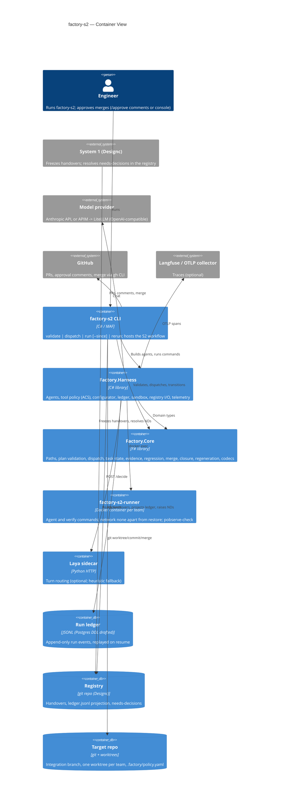
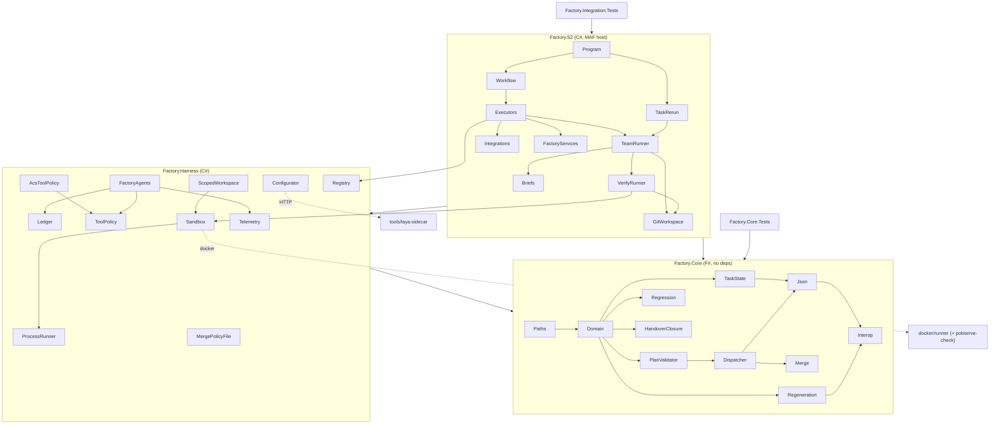

# Architecture — factory-s2 (System 2: coding pipeline)

> Living document. Updated at the end of every /plan execution and
> whenever module boundaries or interfaces change.
> Source of truth for blast radius assessment, onboarding, and enterprise
> architecture aggregation.
> Last updated: 2026-10-07 — live run live2 fixes: each verify check starts from the tree as found
> (VerifyRunner -> GitWorkspace; created directories removed, build caches kept); the Implementer
> hands broken tests back to the TestAuthor (`ReturnedToTestAuthor`, `return_to_test_author`);
> every role's prompt carries the sandbox facts (`prompts/sandbox.md`).
> Previously: 2026-10-07 — live run live1 fixes: checks leave the worktree as found (generated files
> never committed), .NET 8 packs in the runner image (P checks build offline), red runs the sandbox
> could not run park as `environment` (Core `RedRun.classify`).
> Previously: 2026-10-07 — System 2 plan (PLAN.md A–I) complete: Designc handover reader, registry
> projector and needs-decisions, three-gate evidence and P2P regression, merge enforcement, Docker
> sandbox, Anthropic provider, ACS tool policy, Laya configurator, OTel/Langfuse, PObserve,
> `rerun` (k attempts) and the regeneration drill (`run --since`).

## System Overview

System 2 of the design-to-code factory. It takes a handover frozen by System 1 (Designc) and
turns it into merged code in a target repo:
- A planner agent drafts tasks.
- F# rules validate the plan and dispatch it into teams and waves.
- A per-team task loop drives the agents (task planner, TestAuthor, Implementer) inside scoped git
  worktrees. Their commands run in a Docker sandbox.
- Deterministic verify decides pass or fail: red evidence, green, a stashed-implementation run and
  a pass-to-pass check.
- Integration verify runs the whole suite, PObserve and each bound decision's checks.
- A merge policy (auto or tiered, with hard blocks) merges, or opens the PR.

Every step is written to the run ledger and projected into the registry ledger for System 4. Agents
propose; deterministic code decides. The canonical domain vocabulary is
`Designc/app/UBIQUITOUS_LANGUAGE.md`: System 1 owns the contract and this repo adopts its terms.

## Tech Stack

| Layer | Technology | Version |
|-------|-----------|---------|
| Rules (domain) | F# library, FS0025 as error | FSharp.Core 8.0.102, net9.0 |
| Harness | C# library | net9.0; Microsoft.Agents.AI(.OpenAI) 1.15.0, Anthropic 12.49.0, Microsoft.AgentGovernance [5.0.0], OpenTelemetry 1.19.1, YamlDotNet 18.1.0 |
| Host | C# console app, MAF workflows | Microsoft.Agents.AI.Workflows 1.15.0 |
| Sandbox image | Docker Engine CLI, `docker/runner` | .NET 9 SDK, JDK 17, P 3.1.0, PObserve CLI built from p-org/P@260da928 |
| Sidecar / parser | Python 3 (Laya sidecar), Java 17 (PObserve parser) | — |
| Tests | F# console runner (Core), xUnit 2.9.2 (integration; Docker and live tests opt-in) | `dotnet run --project tests/Factory.Core.Tests`, `dotnet test tests/Factory.Integration.Tests` |

## C4 Level 2 — Container Diagram

## Module Map

| Module | Responsibility | Key Types | Dependents | Integrations |
|--------|---------------|-----------|------------|-------------|
| `Factory.Core/Paths.fs` | Safe globs: create, match, overlap (over-approx), containment (under-approx) | `PathPattern` | Domain, PlanValidator, Dispatcher, Merge, Json, Interop, ScopedWorkspace, DesigncHandoverReader, Briefs, TeamRunner | — |
| `Factory.Core/Domain.fs` | Handover, plan and verify types | `Handover`, `ElementSpec`, `BoundDecision`, `PlannedTask`, `VerifyEntry` | every Core module after it, Harness, S2, tests | — |
| `Factory.Core/PlanValidator.fs` | Plan rules (collects all errors); sole constructor of `ValidatedPlan` | `PlanError`, `ValidatedPlan` | Dispatcher, Interop, S2 | — |
| `Factory.Core/Dispatcher.fs` | Overlapping writes -> teams; team DAG -> waves | `Team`, `Wave`, `DispatchPlan` | Merge, Json, Interop, S2 | — |
| `Factory.Core/TaskState.fs` | Task lifecycle, budgets, phases (TestAuthor/Implementer); `Passed` needs three-gate evidence; `replay` | `TaskState`, `TaskEvent`, `RedEvidence`, `PassedEvidence`, `Limits` | Json, Interop, RegistryLedgerProjector, TeamRunner | — |
| `Factory.Core/Regression.fs` | Pass-to-pass: baseline-passing tests that no longer pass | `TestResult` | Interop, VerifyRunner | — |
| `Factory.Core/HandoverClosure.fs` | Handover outcome: delivered only when merged and every decision check passed | `HandoverOutcome` | Interop, RegistryLedgerProjector | — |
| `Factory.Core/Regeneration.fs` | Re-frozen handover vs plan: changed decisions -> tasks to re-run | `Regeneration` | Interop, S2 (Dispatcher, TeamRunner) | — |
| `Factory.Core/Merge.fs` | Merge tier (max over rules), enforcement (auto/tiered), hard blocks | `MergeTier`, `MergePolicy`, `MergeEnforcement`, `MergeBlock`, `MergeVerdict` | Interop, MergePolicyFile, MergeExecutor | — |
| `Factory.Core/Json.fs` | Plan/handover/dispatch/task-event codecs | — | Interop | — |
| `Factory.Core/Interop.fs` | C#-friendly facade | `Core`, `PlanValidation`, `FactoryRejectedException` | Harness, S2 | — |
| `Factory.Harness/FactoryAgents.cs` | Builds every agent: provider client per tier, governed tool calls, gen_ai spans | `GatewayOptions`, `ModelProvider`, `AgentScope`, `FactoryAgents` | S2 executors, TaskLoop | Anthropic API / OpenAI-compatible gateway |
| `Factory.Harness/ToolPolicy.cs` | Role allow-list (fallback and contract double) | `IToolPolicy`, `RoleAllowListPolicy`, `Roles` | FactoryAgents, AcsToolPolicy | — |
| `Factory.Harness/Governance/AcsToolPolicy.cs` | AGT/ACS policy per role from `policies/s2/*.yaml` | `AcsToolPolicy` | Program | Microsoft.AgentGovernance |
| `Factory.Harness/Configurator.cs` | plan/act/escalate + tier: heuristic, Laya, fallback | `IConfigurator`, `HeuristicConfigurator`, `LayaConfigurator`, `FallbackConfigurator` | TaskLoop, Program | Laya sidecar (HTTP) |
| `Factory.Harness/ScopedWorkspace.cs` | Agent tools; refuses writes outside the phase's paths; runs commands in the sandbox | `ScopedWorkspace`, `TurnSignals` | TaskLoop, Planner | File system, sandbox |
| `Factory.Harness/Sandbox/*` | Command sandbox: Docker container per team (default) or scrubbed local | `ISandboxFactory`, `ICommandSandbox`, `DockerSandbox`, `LocalSandbox` | ScopedWorkspace, VerifyRunner, TeamRunner, Program | Docker Engine CLI |
| `Factory.Harness/Registry/*` | Designc handover reader (hash-checked) and DSL model; ledger projection; needs-decision ids/resolutions | `DesigncHandoverReader`, `DslModel`, `RegistryLedgerProjector`, `RegistryNeedsDecisions` | HandoverInput, executors | Registry repo files |
| `Factory.Harness/Policy/MergePolicyFile.cs` | `.factory/policy.yaml` + env override | `MergePolicyFile` | FactorySettings | Target repo file |
| `Factory.Harness/Telemetry/FactoryTelemetry.cs` | OTel attribute contract, run/task spans, task_passed score, tracer provider | `FactoryTelemetry` | FactoryAgents, Workflow, TaskLoop, Program | OTLP (Langfuse) |
| `Factory.Harness/Ledger.cs` | Ledger events (trace_id on every row), JSONL impl | `ILedger`, `LedgerEvent`, `LedgerKinds` | most of Harness and S2 | File system |
| `Factory.Harness/ProcessRunner.cs` | Process with timeout + tree kill | `ProcessRunner`, `ProcessResult` | Sandboxes, GitWorkspace, Integrations | OS processes |
| `Factory.S2/Workflow.cs` | MAF graph + host (merge-approval RequestPort) | `S2Workflow`, `WorkflowHost` | Program, tests | MAF runtime |
| `Factory.S2/Executors/*` | Planner (reuses the previous plan on `--since`), PlanValidator, Dispatcher (writes regeneration.json), Waves (needs-decision park/resume), IntegrationVerify, Merge, Finalize | executor classes, `Messages.cs` | Workflow | Registry |
| `Factory.S2/Teams/TeamRunner.cs` | Per-team loop; TaskLoop drives one task (red, green, stash check, P2P, scope); carries regeneration-unaffected tasks | `TeamRunner`, `TaskLoop`, `TeamResult` | WaveExecutor, TaskRerun | — |
| `Factory.S2/Teams/TaskRerun.cs` | k independent attempts at one task: pass rate, turns, tokens | `TaskRerun`, `RerunReport` | Program (`rerun`) | — |
| `Factory.S2/Teams/Briefs.cs` | Per-turn briefs (incl. the PObserve logging contract); prompts from `prompts/*.md` | `Briefs` | TaskLoop, Planner | — |
| `Factory.S2/Verify/*` | Verify entries in the sandbox, each from the tree as found, cleanup always, JUnit parsing, baseline/regression | `VerifyRunner`, `VerifyOutcome`, `JUnit` | TaskLoop, IntegrationVerify | Sandbox, GitWorkspace |
| `Factory.S2/Git/GitWorkspace.cs` | Integration branch, worktree per team, stash, leave-as-found, idempotent merges | `GitWorkspace` | TeamRunner, TaskRerun, VerifyRunner, executors | git |
| `Factory.S2/Integrations.cs` | PRs (gh / dry-run), approval comments, human channel | `IPullRequests`, `IApprovalComments`, `GhCliPullRequests`, `IHumanChannel` | MergeExecutor, WorkflowHost, Program | GitHub (gh CLI) |
| `Factory.S2/HandoverInput.cs` | `--handover` file or Designc dir -> frozen JSON | `HandoverInput` | Program | Registry |
| `Factory.S2/FactoryServices.cs` | Settings from env, run-dir paths, service bag, re-validating loaders | `FactorySettings`, `FactoryServices`, `RegenerationFile` | every executor, TeamRunner, TaskRerun, Program | env vars |
| `docker/runner` | Runner image (`build.sh`) | — | DockerSandbox (by image name) | Docker |
| `tools/pobserve-parser` | `EventLineParser` (`pobserve <event> <payload>` -> P events), `pobserve-check` | — | runner image, `FACTORY_POBSERVE_CMD` | PObserve CLI |
| `tools/laya-sidecar` | `/decide` HTTP sidecar; `laya_adapter.py` is the one binding point | — | LayaConfigurator | Laya |
| `policies/s2/*.yaml` | ACS policies per role (`planner`, `task-planner`, `test-author`, `implementer`) | — | AcsToolPolicy | — |

## Module Dependency Diagram

## High-Centrality Modules

Modules with multiple dependents — highest blast radius on change.
Used by structural-centrality-guard to determine escalation threshold.

| Module | File Path | Dependent Count | Dependents |
|--------|-----------|----------------|-----------|
| Domain | `src/Factory.Core/Domain.fs` | 12+ | every Core module after it, Harness, S2, tests |
| Paths | `src/Factory.Core/Paths.fs` | 10 | Domain, PlanValidator, Dispatcher, Merge, Json, Interop, ScopedWorkspace, DesigncHandoverReader, Briefs, TeamRunner |
| Ledger | `src/Factory.Harness/Ledger.cs` | 9 | FactoryAgents, DockerSandbox, RegistryLedgerProjector, VerifyRunner, FactoryServices, PlanningExecutors, RunExecutors, TeamRunner, TaskRerun |
| FactoryServices | `src/Factory.S2/FactoryServices.cs` | 7 | PlanningExecutors, RunExecutors, Workflow, TeamRunner, TaskRerun, Messages, Program |
| Sandbox | `src/Factory.Harness/Sandbox/ICommandSandbox.cs` | 6 | Local/DockerSandbox, ScopedWorkspace, VerifyRunner, FactoryServices, TeamRunner, Program |
| Interop | `src/Factory.Core/Interop.fs` | 6+ | every Harness/S2 file that uses `Core.*` |
| PlanValidator | `src/Factory.Core/PlanValidator.fs` | 5 | Dispatcher, Interop, FactoryServices, PlanningExecutors, Program |
| Telemetry | `src/Factory.Harness/Telemetry/FactoryTelemetry.cs` | 4 | FactoryAgents, Workflow, TeamRunner, Program |
| TaskState | `src/Factory.Core/TaskState.fs` | 4 | Json, Interop, RegistryLedgerProjector, TeamRunner |
| ProcessRunner | `src/Factory.Harness/ProcessRunner.cs` | 4 | DockerSandbox, LocalSandbox, GitWorkspace, Integrations |
| Regeneration | `src/Factory.Core/Regeneration.fs` | 4 | Interop, FactoryServices, PlanningExecutors, TeamRunner |

## Integration Points

| System | Protocol | Direction | Canonical Name | Notes |
|--------|---------|-----------|---------------|-------|
| System 1 registry | Files (git repo) | In/Out | Designc registry | Reads `handovers/<id>/` (hash-checked); appends the S2 projection to `ledger.jsonl`; needs-decisions raised/resolved there |
| Model provider | HTTPS | Out | Anthropic API, or APIM -> LiteLLM | `FACTORY_PROVIDER=anthropic|openai`; key never reaches sandbox, ledger or traces |
| GitHub | gh CLI | Out/In | GitHub | PR create, `/approve` and `/verified` comments from the allow-list, squash merge; dry-run writes to `.factory/runs/<id>/` |
| git | CLI | Out | target repo | integration branch, worktrees under the state dir |
| Docker Engine | CLI | Out | factory-s2-runner | container per team, `--network none` apart from the restore window |
| Laya | HTTP `/decide` | Out | Laya sidecar | optional (`FACTORY_LAYA_URL`); heuristic fallback, decider ledgered |
| Langfuse / OTLP | OTLP | Out | Langfuse | only when `OTEL_EXPORTER_OTLP_ENDPOINT` set; content off unless `FACTORY_OTEL_CAPTURE_CONTENT=1` |
| PObserve | CLI in the runner image | Out | PObserve | `pobserve-check <specs> <Spec> <logs>` via `FACTORY_POBSERVE_CMD`; exit 2 spec violation, 4 parse error |
| Human | Console / RequestPort | In/Out | — | merge approval without `--github` |

## Domain Rules Extracted

| Rule | Location | Type | Notes |
|------|---------|------|-------|
| `Passed` needs red evidence, all-green automated outcomes and a stashed-impl run that fails | `TaskState.fs` `PassedEvidence` | Invariant (type-enforced) | private ctors |
| TestAuthor writes only `testWrites`, Implementer only `writes`; disjoint | `PlanValidator.fs`, `ScopedWorkspace.cs` | Invariant | scope enforced by tools and after each turn |
| A test that passed in the team baseline and fails now blocks green (P2P) | `Regression.fs`, `TaskLoop` | Business rule | missing test counts as failing |
| A red run with any check the sandbox could not run (NU1301, exit 127) is no evidence: the task parks, source `environment` | `TaskState.fs` `RedRun.classify`, `TaskLoop.TestsDoneAsync` | Business rule | before the Implementer's first turn |
| Checks (baseline, red, green + P2P, stash check) leave the worktree as they found it | `GitWorkspace.LeaveAsFoundAsync`, `TaskLoop`, `TaskRerun` | Invariant | generated output never reaches a commit |
| Each verify check starts from the tree as found: files and created directories (ignored ones too) are removed before the next check; bin/, obj/, node_modules/ are kept | `VerifyRunner.RunTaskAsync`, `GitWorkspace.LeaveAsFoundAsync` | Invariant | one check cannot break another |
| The Implementer may hand broken tests back to the TestAuthor (`Ready(Implementer) -> Ready(TestAuthor)`); shares the turn budget and needs a new red run | `TaskState.fs` `ReturnedToTestAuthor`, `TaskLoop` | Business rule | instead of parking on a needs-decision |
| `ValidatedPlan` only constructible by `PlanValidator.validate` | `PlanValidator.fs` | Invariant | internal ctor |
| Every task needs ≥1 automated verify under its testWrites or a protected path; every bound decision covered | `PlanValidator.fs` | Business rule | "nothing done without a check" |
| Merge: blocks (scope leak, protected path, pending manual check) stop both modes; auto merges on green; tiered needs approvals by tier | `Merge.fs` | Business rule | thresholds in `.factory/policy.yaml` (400 lines, low risk) |
| Handover delivered only when merged and every check of every bound decision passed | `HandoverClosure.fs` | Business rule | projected to the registry |
| Regeneration re-runs a task only if it covers or touches the elements of a changed decision | `Regeneration.fs` | Business rule | element-only changes and dependents do not re-run |
| Stall: N turns with no worktree change -> needs-decision | `Configurator.cs`, `TaskLoop` | Business rule | heuristic |

## Known Risks

| Area | Risk | Confidence |
|------|------|-----------|
| MAF version | Pinned at 1.15.0 (NuGet newer); `[MessageHandler]` generator unused (needs .NET 10 Roslyn) | Medium |
| AGT quirk | AGT 5.0.0 `in [..]` conditions never match; policies use one rule per tool | High (verified) |
| PObserve paths | Under Docker the specs dir in `FACTORY_POBSERVE_CMD` must be inside the worktree mount | High (documented) |
| Regeneration scope | Dependents of a re-run task are not re-run; only integration verify catches a broken dependent | Medium |
| Rerun fidelity | `rerun` does not replay dependency tasks; `--base` must carry their work | Medium |
| Verify cost | VerifyRunner starts a container per call under Docker: slow | Medium |

## Security Risks

> Only populated when `/explore-codebase --security` has been run.

| Severity | OWASP Category | File | Pattern | Suggested Fix |
|----------|---------------|------|---------|--------------|
