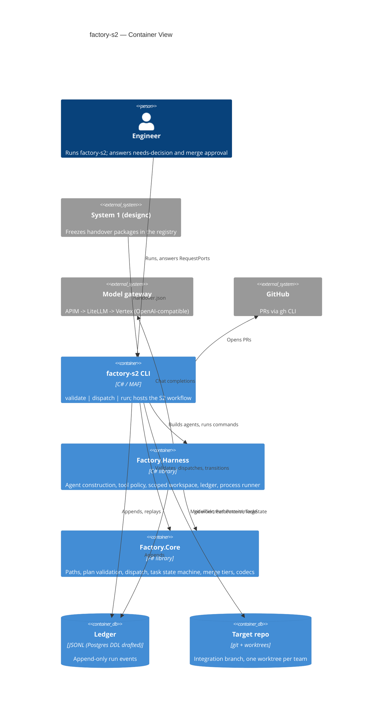
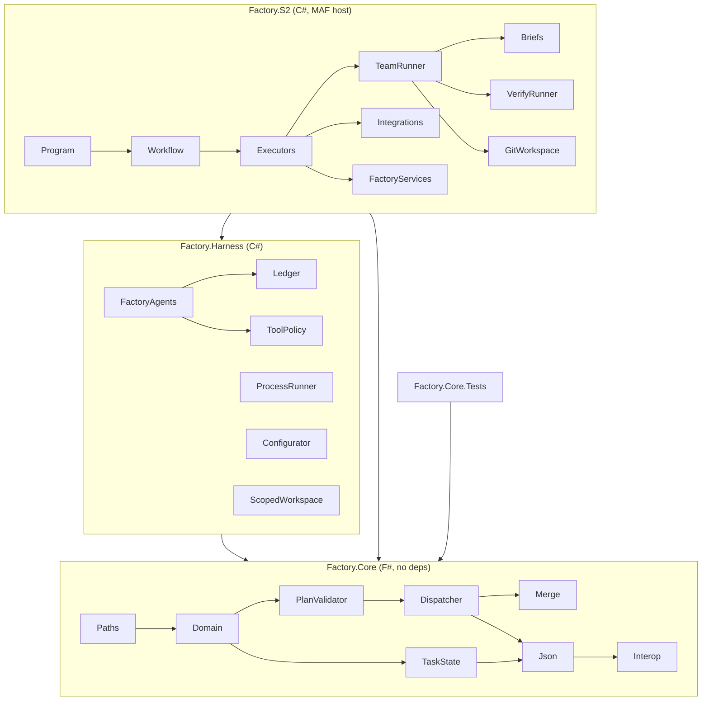

# Architecture — factory-s2 (System 2: coding pipeline)

> Living document. Updated at the end of every /plan execution and
> whenever module boundaries or interfaces change.
> Source of truth for blast radius assessment, onboarding, and enterprise
> architecture aggregation.
> Last updated: 2026-10-07 — baseline mapped from the workbook as delivered (12 TODO(you) stubs open, MAF code uncompiled), before the System 2 plan.

## System Overview

System 2 of the design-to-code factory. It takes a frozen handover package from System 1
(designc) and turns it into merged code in a target repo: a planner agent drafts tasks, F# rules
validate and dispatch them into teams and waves, a per-team turn loop drives agents inside scoped
git worktrees, deterministic verify decides pass/fail, and a tiered merge policy opens the PR.
Every step is written to a ledger so System 4 can learn from it. Agents propose; deterministic
code decides. Canonical domain vocabulary: `Designc/app/UBIQUITOUS_LANGUAGE.md` (System 1 owns the
contract; this repo adopts its terms).

## Tech Stack

| Layer | Technology | Version |
|-------|-----------|---------|
| Rules (domain) | F# library, FS0025 as error | FSharp.Core 8.0.102, net8.0 (SDK on box: 9.0.301) |
| Harness | C# library | net8.0, Microsoft.Agents.AI / .OpenAI 1.15.0 (pinned; NuGet latest 1.23.0) |
| Host | C# console app, MAF workflows | Microsoft.Agents.AI.Workflows 1.15.0 |
| Tests | F# console test runner (no framework) | `dotnet run --project tests/Factory.Core.Tests` |
| Contracts | JSON Schema (plan, handover), Postgres DDL (ledger) | — |

## C4 Level 2 — Container Diagram

## Module Map

| Module | Responsibility | Key Types | Dependents | Integrations |
|--------|---------------|-----------|------------|-------------|
| `Factory.Core/Paths.fs` | Safe globs: create, match, overlap (over-approx), containment (under-approx) | `PathPattern` (private repr) | Domain, PlanValidator, Dispatcher, Merge, Json, Harness (ScopedWorkspace), S2 | — |
| `Factory.Core/Domain.fs` | Handover, plan and verify types | `Handover`, `ElementSpec`, `BoundDecision`, `PlannedTask`, `VerifyEntry`, `ModelTier`, `RiskLevel` | every Core module after it, Harness, S2, tests | — |
| `Factory.Core/PlanValidator.fs` | 17 plan rules, collects all errors; sole constructor of `ValidatedPlan` | `PlanError`, `ValidatedPlan` (internal ctor) | Dispatcher, Interop, S2 executors | — |
| `Factory.Core/Dispatcher.fs` | Overlapping writes -> teams; cross-team cycles merged; team DAG -> waves | `Team`, `Wave`, `DispatchPlan` | Merge, Json, Interop, S2 (Waves, TeamRunner) | — |
| `Factory.Core/TaskState.fs` | Task lifecycle + budgets; `Passed` needs `PassedEvidence`; `replay` from ledger | `TaskState`, `TaskEvent`, `PassedEvidence`, `Limits` | Json, Harness (Configurator), S2 (TeamRunner) | — |
| `Factory.Core/Merge.fs` | Tiered merge autonomy (max tier over rules, keep reasons) | `MergeTier`, `MergePolicy`, `MergeVerdict` | S2 (MergeExecutor) | — |
| `Factory.Core/Json.fs` | Plan/handover/dispatch/task-event codecs, collect every error | — | Interop, Harness ledger payloads, S2 | — |
| `Factory.Core/Interop.fs` | C#-friendly facade | `Core`, `PlanValidation`, `FactoryRejectedException` | Harness, S2 | — |
| `Factory.Harness/FactoryAgents.cs` | Builds every agent: gateway client + governed tool-call middleware | `GatewayOptions`, `AgentScope`, `FactoryAgents` | S2 executors, TeamRunner | Model gateway (OpenAI-compatible) |
| `Factory.Harness/ToolPolicy.cs` | Role allow-list (stand-in for AGT/ACS) | `IToolPolicy`, `PolicyDecision`, `Roles` | FactoryAgents | — |
| `Factory.Harness/ScopedWorkspace.cs` | Agent tools; refuses writes outside task writes; signals via tools | `ScopedWorkspace`, `TurnSignals` | TeamRunner | File system |
| `Factory.Harness/Configurator.cs` | plan/act/escalate + tier; heuristic default | `IConfigurator`, `TurnContext`, `ConfiguratorDecision` | TeamRunner | (Jev/Laya slot) |
| `Factory.Harness/Ledger.cs` | Ledger events, JSONL impl | `ILedger`, `LedgerEvent`, `LedgerKinds` | FactoryAgents, VerifyRunner, TeamRunner, executors | File system |
| `Factory.Harness/ProcessRunner.cs` | Shell with timeout + process-tree kill | `ProcessRunner`, `ProcessResult` | GitWorkspace, VerifyRunner, ScopedWorkspace, Integrations | OS processes |
| `Factory.S2/Workflow.cs` | MAF graph + host (RequestPort round trips) | `S2Workflow`, `WorkflowHost` | Program | MAF runtime |
| `Factory.S2/Executors/*` | Planner, PlanValidator, Dispatch, Waves, IntegrationVerify, Merge, Finalize | executor classes, `Messages.cs` records | Workflow | — |
| `Factory.S2/Teams/*` | Per-team turn loop; per-turn briefs from plan+handover+ledger | `TeamRunner`, `TaskLoop`, `Briefs` | WaveExecutor | — |
| `Factory.S2/Verify/VerifyRunner.cs` | Run verify entries; cleanup always; failed cleanup = failure | `VerifyRunner` | TeamRunner, IntegrationVerify | OS processes |
| `Factory.S2/Git/GitWorkspace.cs` | Integration branch, worktree per team, idempotent merges | `GitWorkspace` | TeamRunner, executors | git |
| `Factory.S2/Integrations.cs` | PRs (gh / dry-run), human channel (console) | `IPullRequests`, `IHumanChannel` | MergeExecutor, WorkflowHost | GitHub (gh CLI) |
| `Factory.S2/FactoryServices.cs` | Settings from env + service bag | `FactorySettings`, `FactoryServices` | all executors, TeamRunner | env vars |

## Module Dependency Diagram

## High-Centrality Modules

Modules with multiple dependents — highest blast radius on change.
Used by structural-centrality-guard to determine escalation threshold.

| Module | File Path | Dependent Count | Dependents |
|--------|-----------|----------------|-----------|
| Domain | `src/Factory.Core/Domain.fs` | 9 | PlanValidator, Dispatcher, TaskState, Merge, Json, Interop, Harness, S2, tests |
| Paths | `src/Factory.Core/Paths.fs` | 7 | Domain, PlanValidator, Dispatcher, Merge, Json, ScopedWorkspace, S2 |
| TaskState | `src/Factory.Core/TaskState.fs` | 4 | Json, Configurator, TeamRunner, tests |
| Ledger | `src/Factory.Harness/Ledger.cs` | 5 | FactoryAgents, VerifyRunner, TeamRunner, executors, Briefs |
| ProcessRunner | `src/Factory.Harness/ProcessRunner.cs` | 4 | GitWorkspace, VerifyRunner, ScopedWorkspace, Integrations |
| FactoryServices | `src/Factory.S2/FactoryServices.cs` | 4+ | every executor, TeamRunner |
| PlanValidator | `src/Factory.Core/PlanValidator.fs` | 3 | Dispatcher, Interop, executors |

## Integration Points

| System | Protocol | Direction | Canonical Name | Notes |
|--------|---------|-----------|---------------|-------|
| System 1 registry | File (handover.json) | In | designc registry | Workbook assumes JSON; designc actually freezes `handovers/<id>/handover.yaml` + copies |
| Model gateway | HTTPS, OpenAI-compatible | Out | APIM -> LiteLLM -> Vertex | `FACTORY_GATEWAY_URL/KEY`, tier aliases |
| GitHub | gh CLI | Out | GitHub | PR create, auto-merge; dry-run writes to `.factory/runs/<id>/` |
| git | CLI | Out | target repo | worktrees under state dir |
| Human | Console / RequestPort | In/Out | — | needs-decision answers, merge approval |
| PObserve | CLI via `FACTORY_POBSERVE_CMD` | Out | PObserve | optional |

## Domain Rules Extracted

| Rule | Location | Type | Notes |
|------|---------|------|-------|
| `Passed` only from non-empty, all-exit-0 automated outcomes | `TaskState.fs` `PassedEvidence.Create` | Invariant (type-enforced) | private ctor |
| Budgets enforced on entry to `Running` / `Verifying` | `TaskState.fs` (TODO) | State machine | not by agents/prompts |
| `ValidatedPlan` only constructible by `PlanValidator.validate` | `PlanValidator.fs` | Invariant | internal ctor |
| Overlap errs toward "may overlap"; containment errs toward "not inside" | `Paths.fs` (TODO) | Soundness | protects team isolation / element scope |
| Every task needs ≥1 automated verify; every bound decision covered | `PlanValidator.fs` | Business rule | "nothing done without a check" |
| Merge tier = max over rules; changed file outside all writes -> TwoApprovals | `Merge.fs` (TODO) | Business rule | thresholds in `defaultPolicy` (magic: 400 lines, Low risk) |
| Writes outside task writes refused by tools, reverted after each turn | `ScopedWorkspace.cs`, `TeamRunner.EnforceScopeAsync` | Invariant | scope enforced 3x |
| Cleanup always runs; failed cleanup = failure | `VerifyRunner.cs` (TODO) | Business rule | `FACTORY_VERIFY_NS` per attempt |
| Stall: N turns with no worktree change -> escalate | `Configurator.cs` (`stallTurns = 2`) | Business rule | heuristic |

## Known Risks

| Area | Risk | Confidence |
|------|------|-----------|
| MAF API drift | Code written against 1.15 docs, never compiled; NuGet is at 1.23 | High |
| Handover contract | Workbook `handover.json` does not match designc's frozen `handover.yaml` + model copy | High (verified) |
| Ledger contract | Workbook ledger kinds/fields differ from designc's `ledger_schema.json` | High (verified) |
| Test gaming | Task `writes` include its own test project; verify runs those tests | High |
| Untrusted execution | Agent-written code/tests run as the user with full env (keys, gh token, network) | High |
| Repo hygiene | Workbook sits in an un-committed parent repo (`~/Desktop/Coding`) | High |
| Target framework | net8.0 targets, only .NET 9 SDK/runtime on box | Medium |

## Security Risks

> Only populated when `/explore-codebase --security` has been run.

| Severity | OWASP Category | File | Pattern | Suggested Fix |
|----------|---------------|------|---------|--------------|
