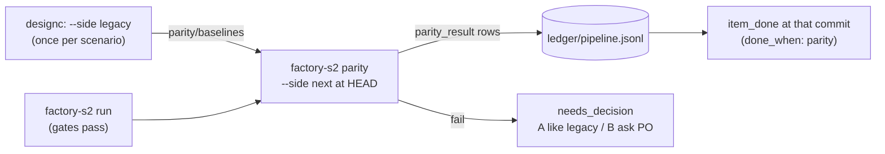

# Legacy parity on the work VM

The recorder runs on the work VM only, never in CI. Legacy is always live **dev** with real data, never mocks.
designc owns the comparison and the rules ([designc `docs/parity-contract.md`](../../../Designc/app/docs/parity-contract.md)).
S2 only runs designc's recorder for a work item and turns failures into decisions.



## One-time setup

```sh
cd ~/Desktop/Coding/Designc/app   # wherever designc is checked out on the VM
npm i
npx playwright install chromium
export FACTORY_DESIGNC_DIR=$PWD
```

Set the two URLs on the work VM, in designc's Set up, where the legacy reference is already set. They are stored
in the registry's `designc.json`: the legacy dev URL on the legacy reference (or `parity.legacy.baseUrl`), and the
new app's test environment in `parity.next.baseUrl`. S2 holds no URLs: `factory-s2 parity` lets designc's recorder
read them, and `--base-url` overrides the new app's URL for one run (for example, a commit served locally).

The new app's test environment is the only place where `--allow-writes` would ever be acceptable. S2 never passes
it, and nothing passes it against legacy.

## Baselines (designc, a person)

Record legacy once per scenario, and again when legacy changes:

```sh
node scripts/parity-record.js --registry <registry> --scenario all --side legacy
```

S2 never writes `parity/scenarios/` or `parity/baselines/`.

## Per work item (after its gates pass)

1. Deploy the item's commit to the new app's test environment, or serve it locally and pass `--base-url`.
2. Run, from a clean checkout at that commit:

   ```sh
   factory-s2 parity --registry <registry> --item W-1 --repo <new app repo> [--base-url <url>]
   ```

| Exit | Meaning | Next |
|---|---|---|
| 0 | every scenario passed | record `item_done` at the same commit (it must be reachable from main) |
| 1 | a scenario failed | a `needs_decision` is open: A build it like legacy, or B ask the PO for a business decision |
| 3 | could not run (for example, no row matched) | fix the data or the scenario params; nothing to decide |
| 2 | recorder error, or the worktree is dirty | infrastructure: nothing was judged |

Merge with `--no-ff` (S2's integration already does). After a squash merge, re-run parity at the commit that landed,
because Done needs a pass at the done commit.

A dry run without a browser: `--adapter fixture:<designc>/fixtures/parity-registry/apps/next.json` against a copy of
that fixture registry.
